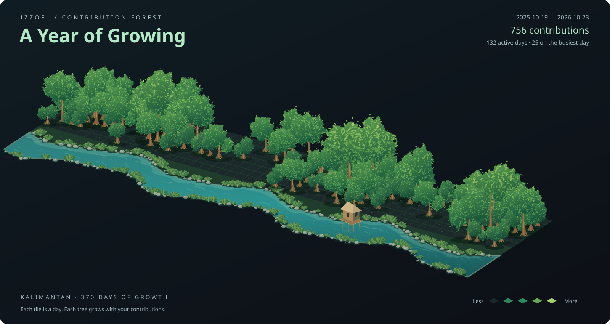

## Greeting 👋 ##

### My name **Zulfahmi Ramadhani**  
I am a self-taught programmer with experience in networking 🌐, robotics 🤖 and machine learning 🖥. 
Currently, I am focused on web-based development.

> [!NOTE]
>This is a collection of my work. Some projects are still in development, while others have been released. Please use them wisely.
> - Z.R 17/08/2024 

## Languages ##

## Frameworks & Libraries ##

## Tools & Technologies ##

## Github Stats

## Contribution Forest ##

  

A year of growing — one day, one tile. Updated daily with my GitHub contribution calendar.

---

  

